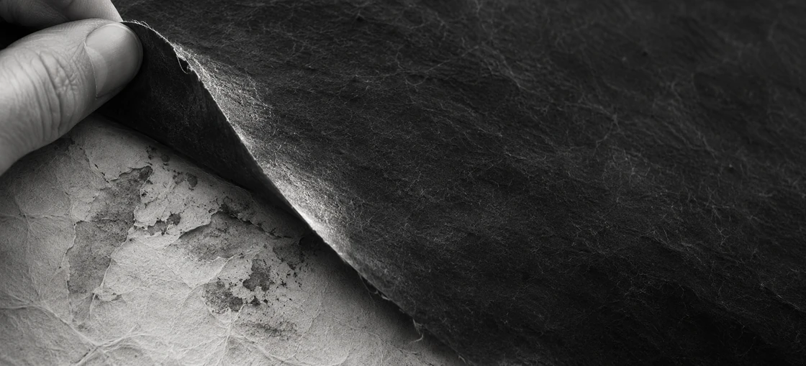

<header><h1>Pranav Garg</h1>
Cofounder of <a href="https://koloapp.in">Kolo</a>, advisors for Indian homeowners building a home.

I do nearly all my product and business work through Claude, and write about what works and what doesn't.
</header>
<figure class="hero"></figure>
<nav class="home-nav" aria-label="Homepage navigation">
<a class="t" href="work/">Work</a>
<a class="t" href="explorations/">Explorations</a>
<a class="t" href="https://www.linkedin.com/in/pranav6082/">LinkedIn</a>
</nav>

<a href="llms.txt">For AI agents</a>

