# How I Claude

*Pranav Garg, cofounder of Kolo. Also on [LinkedIn](https://www.linkedin.com/pulse/how-i-claude-pranav-garg-eh1nf).*

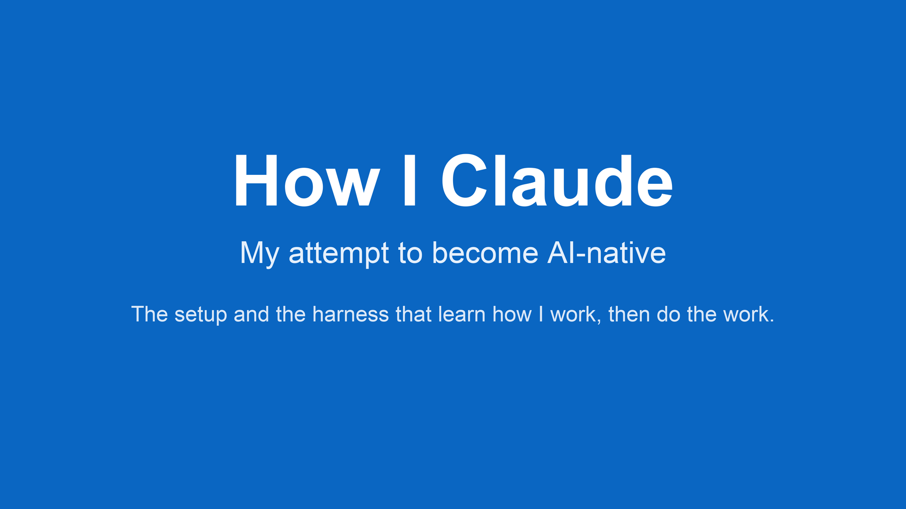

How I Claude is my write up on becoming AI-native. For me, AI-native is about driving <strong>outcome for the business</strong> by harnessing this super intelligence, which can do all kinds of digital laptop work.

The measure is, first, business outcomes - increase top line (increase revenue), improve bottom line (bring down costs).

Second, do I continue to be <strong>needed less and less for a task type</strong>, and as a result can I then take up more task types.

Both depend on one thing - I can only be needed less when the output can be trusted. <strong>Getting a reliable output is the hard part</strong>.

<strong>100% of my work</strong> happens through the Claude chat window. I run product and business operations at <a href="https://koloapp.in">Kolo</a>, a home construction advisory platform for homeowners in India.

I have <strong>taught Claude how I work</strong> - from prioritisation to questions I ask, to the way I reply on email and Slack, to the way I build landing pages, and so on.

Let's dive into

<ol><li>what's the setup I do that with</li><li>what's the platform that drives, controls and improves that setup - the harness</li><li>what it took to get here</li><li>what it has done so far for the business.</li></ol>
<h2>Who this article is for</h2>
<ol><li><strong>Someone already AI-native.</strong> They have their own setup.</li><li><strong>Someone not AI-native yet.</strong> But wants to. They already know AI is the frontier. Extreme outcomes with extremely low cost is a given.</li><li><strong>Just exploring.</strong> Please take what suits you :)</li></ol>

Each section says who it is mostly for.

The setup is individual, because the models are evolving, the harness around the model is evolving, and different people from different domains and levels of experience will use it very differently. There is no standard "this is how you work" yet.

<strong>A few words I use throughout</strong>

<ol><li><strong>Thread</strong> - one chat with Claude. A session is the same thing.</li><li><strong>Task type</strong> - a kind of work that repeats, like an email to a partner or the monthly books close.</li><li><strong>Project pod</strong> - one goal of the company, like app subscriptions or bookkeeping, with its own group of threads in the Claude app.</li><li><strong>Skill</strong> - a written way of doing one whole job, which Claude follows.</li><li><strong>Harness</strong> - everything around the model that makes it work my way: the rules, the skills and the checks, all kept as files.</li><li><strong>Steer</strong> - when I correct what a thread is doing.</li><li><strong>Pulled in</strong> - when a thread makes me spend time on something that was not my call.</li></ol>
<h2>1. The setup</h2>

<em>Mostly for: already AI-native. An FYI for the rest.</em>

I talk to Claude by voice - Wispr Flow and Kivi (voice typing apps) - on the Mac desktop app. Same on the phone - Wispr Flow is quite amazing on Android.

The setup is built around "<strong>project pods</strong>". Business outcomes are driven by net effect of projects across the company.

I first set up my Claude threads like a human team, by function - analytics, web dev, android dev..and so on. It didn't work, because with AI agents the work doesn't split by function. I wrote about that <a href="2026-10-28-organising-claude-threads.html">here</a> in detail on LinkedIn.

These pods are not like human teams. Marketing, Android, web dev, QA are like horizontal capabilities - every pod uses all of them.

<strong>The parts</strong>

1. <strong>Intake.</strong> It reads everything that comes in on Slack, email and meeting recordings, and creates one tracked task for each piece of work - a GitHub issue, with duplicates merged.

2. <strong>Relay.</strong> Picks up emails I forward and on slack the messages I put a 📮 emoji on, as a task to be done by the Claude Mac app.

Intake and relay are programs which run on my laptop about every 5 minutes, so the laptop has to stay on and connected to the internet.

3. <strong>Project pod.</strong> It is a project group in the Claude app. Every project has a specific objective, and the context around it. App subscriptions, harness, bookkeeping - are examples of some of the projects. There are 16 project groups today.

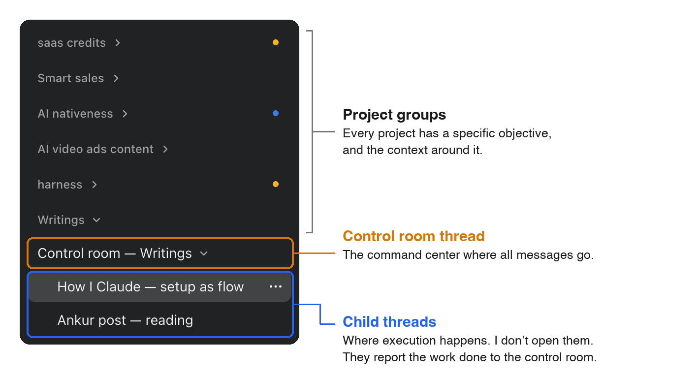

[[PIC 01]]

4. <strong>Control room</strong> per project. The command center where all messages go: mine, or from other control rooms, or from the master thread.

5. <strong>Child threads.</strong> Where execution happens. I don't open child threads. Child threads report the work done to the control room.

The reason is that at a single time, for a project, I could be working on 5 or 10 items, and each one will be taken up by its own child thread. Today 99 threads are open, and 60 were active in the last week.

6. <strong>Master thread.</strong> Over all of them. It can control all control rooms. The relay sends each piece of work to the control room it belongs to. Work with no matching control room comes to the master thread, and the master thread relays it to the relevant control room.

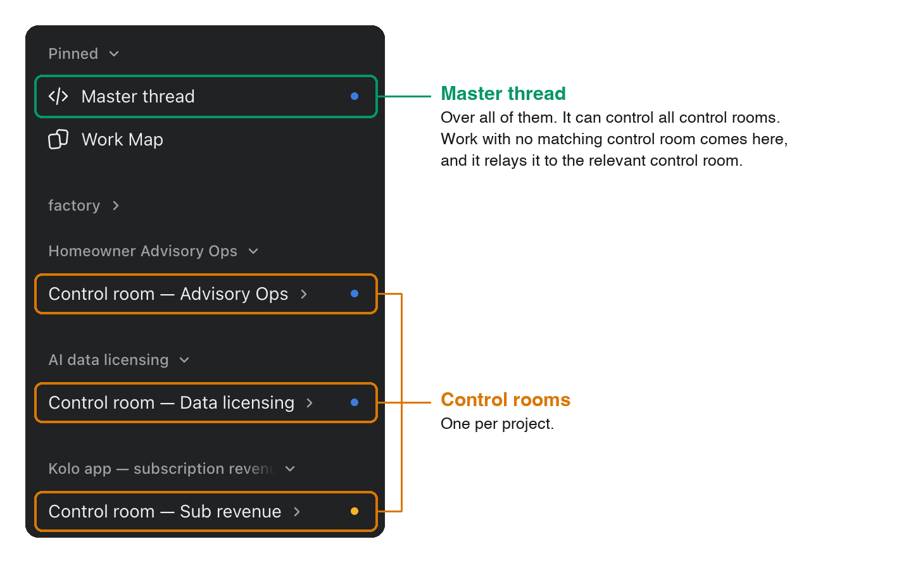

[[PIC 02]]

Work gets injected into the flow in three ways.

1. <strong>The intake</strong> reads everything that comes in and creates that tracked task.

<ol><li>If that issue is an ops process with a predefined flow, which is turned into a "skill", then it runs automatically and does what that flow does. When it is done the issue is closed.</li><li>Anything without a flow waits for me.</li></ol>

2. If I forward an email or put a 📮 emoji on a Slack message, which I can do from my phone, the intake passes that on to a relay which picks up that task to be done by the Claude Mac app. My email forward or emoji on a Slack message is like an approval.

3. I say it myself, in the master thread or in a control room.

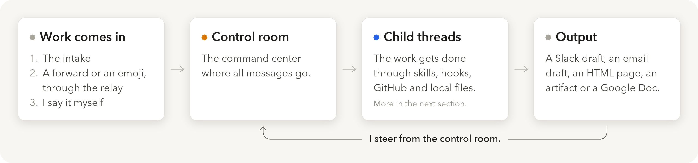

[[PIC 03]]

<em>Mobile friendliness</em>

<ol><li>All control room threads are <strong>remote control enabled</strong> on Claude desktop - I can carry on any of them from my phone</li><li>Every control room has an <strong>artifact</strong> - a web page Claude keeps up to date - which I can comment on from laptop or phone. A note left on a page has to save.</li><li>The master has a <strong>single work map</strong> - one page of everything that is live. It refreshes when I open it, at zero tokens, and its link is the first line of every reply, because the pinned sidebar isn't on the phone.</li><li><strong>An approval I type in the control room counts.</strong> I'll not switch threads - that's just adding more steps.</li></ol>

<strong>How the parts work together</strong>

End to end, one piece of work goes like this:

<ol><li>It comes in one of the three ways above.</li><li>It lands in the control room of its project, or the master thread sends it there.</li><li>A child thread does it, with skills, tools and hooks (all in section 2), from GitHub and local files.</li><li>An output comes back - a Slack draft, an email draft, a page, an artifact or a Google Doc.</li><li>I check it in the control room. <strong>I approve, or I steer.</strong></li><li>Wherever I had to steer gets logged, and <strong>the fix goes back into the harness</strong> - section 2.</li></ol>
<h2>2. The harness</h2>

<em>Mostly for: already AI-native.</em>

Harness is what makes the system on top of the base model (the LLM), not tied to Claude as the LLM, or Codex as the LLM, or to one machine. The rules file, the skills, and how I work, codified - all of it is files synced to GitHub.

On a new laptop or a new harness tool I can say "get the context from that folder", and there is no tying to a certain LLM.

In daily use too - I discussed the next article in a Codex thread, Fable, another model, reads drafts as a second reader, and images have been tried with GPT's image models.

<strong>Getting a reliable output is the hard part</strong>, and that's why verifiability comes in quite strongly.

Each domain has its own:

<ul><li>bookkeeping has its own fundamental of verification,</li><li>backend has unit and integration test cases</li><li>web and mobile the exact customer flows are run visually.</li><li>Design for instance has no verifiability as such.</li><li>And when analytics joins multiple sources, how do you really know it's the right data?</li></ul>

Every issue the harness logs becomes a test case, so the checks build up as we go. So the harness is what continues to improve reliability - each part below is there for that.

Harness is the horizontal base all projects run on. It has 2 layers:

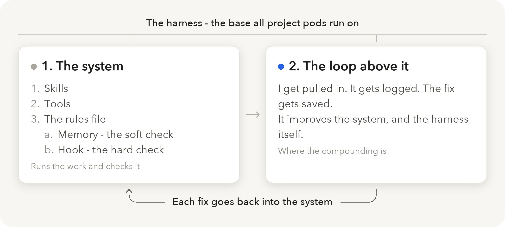

[[PIC 04]]

<h3>1. The system</h3>

It runs the work with skills, tools and the rules file. Memory and hooks sit inside the rules file and check the work. <strong>The checks are where reliability comes from.</strong>

1. <strong>Skills.</strong> This part is what closely emulates how I work and plays a part to get Claude to work the same way.

A skill is a written way of doing one whole job - the monthly books close, tracing a new sale, email drafts, Slack drafts, an Android release, LinkedIn posts etc. There are 29 today.

2. <strong>Tools.</strong> How Claude reaches the work, tried in this order: connectors (ready-made links to apps like Gmail and Slack) → APIs with keys → command-line tools → my Chrome → computer use.

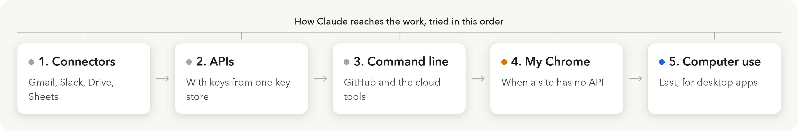

[[PIC 05]]

Before any of this, the work has to have a digital record. Phone calls and meetings need to be recorded - if the raw data is not stored digitally, nothing can be done. Then the tools have to be such that agents can reach everything seamlessly: simple APIs, or CLIs if possible.

The worst way is computer use, where it browses the website to do the operation. For example, the tax portal has no API to download a challan, so Claude uses the browser and waits on the captcha. It is also the least reliable way - a page changes, or a captcha stops it.

3. <strong>The rules file.</strong> One file of standing rules, 397 lines, read at the start of every session - draft and never send, every piece of work gets a tracked issue, plain English first etc. For every type of mistake there is an attempt at a remedy. There are two kinds of checks - soft and hard.

a. <strong>Memory - the soft check.</strong> A saved correction. Claude reads it and mostly follows it.

There are 478 memory notes.

Examples :

<ul><li>Lists I get should always be numbered</li><li>When writing articles, my line breaks stay as I wrote them</li></ul>

Each one is a correction made once.

Harness and overall system has to be modeled in a way that it is token efficient. Not as an afterthought. Some rules related to it :

<ol><li>For token consumption, the auto compact rule was iterated, and now it's working. A thread is measured by its size in tokens, not by messages. It compacts early, and only between turns. Before that, 126 of 149 compactions fired in the middle of a task.</li><li>A thread that runs away gets paused. One email draft thread used 12.8% of a week's limit over 1,155 turns.</li><li>There is a script on local which doesn't take any tokens. The routine part runs as a script, and Claude wakes only when there is something new to judge.</li><li>A cheap text match decides if something is worth a look, and a small, cheaper model gives the verdict, at about a tenth of a cent each.</li><li>Rules load only when the task needs them. Memory has a size cap and a monthly clean-up.</li><li>Background jobs check the weekly budget before they start, and a big job says its cost first.</li></ol>

<strong>b. Hook - the hard check.</strong> A check that runs by itself and blocks a known mistake.

There are 57 hooks - one blocks a code change that names no tracked task in github, one keeps a control room from doing the work itself, one watches how big each thread has grown etc.

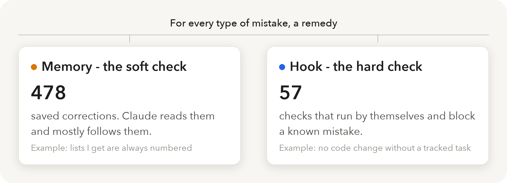

[[PIC 06]]

Why the hard checks are needed: a skill for email or Slack drafts, or something written in a doc, gets missed in 80-90% of cases. But something random mentioned even only once may get clinged to super aggressively. This may change from model to model. <strong>So a mistake that matters gets a hook, not just a note.</strong>

A mistake gets caught in one of three ways.

<ul><li>Claude checks on command</li><li>Claude checks automatically</li><li>or I point out the error</li></ul>

<strong>Reliability goes up as more mistakes move from the last way to the first two.</strong>

<h3>2. Correcting and compounding loop above it</h3>

<strong>The real compounding is in self-improving.</strong> It understands the context of a specific task, how I am working today, and then continues to build on top of it tomorrow.

There is a system. Memory, hooks and skills control that system. This loop is <strong>the meta of the meta</strong> - it improves that whole system, as well as the harness itself.

The trigger is - <strong>If I am getting pulled in and my time is getting spent, then that gets automated.</strong>

This is what moves the second measure - being needed less and less for a task type. I can only be needed less when the output can be trusted, so this loop is also what pushes reliability up.

Pulled in means a thread made me spend time on something that was not my call. For example:

<ol><li>I got half a draft and had to ask for the full one.</li><li>I had to approve something I had already approved.</li><li>I had to correct a wrong default.</li><li>I had to say again what I had already said.</li></ol>

My calls stay with me : a real decision, a yes to send, deploy or pay, or a fact only I have.

Every time I step in, it gets logged with my exact words and the fix. That log has 259 entries since 29 Oct.

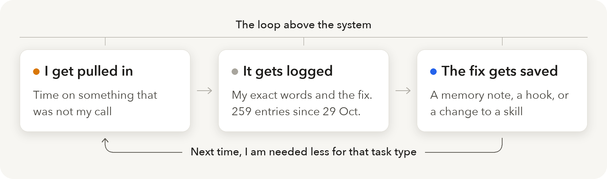

[[PIC 07]]

For instance, one from this article. A new version of the draft dropped the blank lines I had added. I pointed it out, and it was logged that day. A memory note already said my line breaks stay as I wrote them. It did not hold, so a hard check has been asked for. <strong>A soft check that leaks becomes a hard one.</strong>

<strong>The morning review - my evals.</strong> A review reads where I had to steer and saves the lesson where it will bind next time. The lesson gets saved as a memory note, a hook, or a change to a skill.

<strong>Whatever pulls me in most often gets fixed first.</strong> Then the next one.

Take Slack and email drafts. The tone went back and forth between Claude and me many times. Then it was hardened into skills. Then Claude did not call the skill. Newer models miss that less.

Even if the fix is not proper, my judgment will come in, and for the next fix that judgment can get used.

<strong>The harness in numbers, as of Nov 2026</strong>

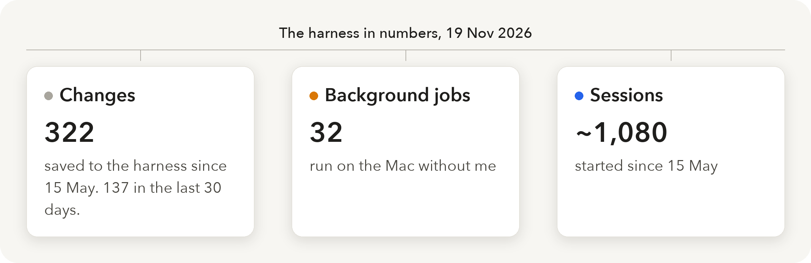

[[PIC 08]]

The harness started on May 2026. In the six months since, it has had 322 changes saved to it. That is almost two a day. 137 of those came in the last 30 days.

32 background jobs on the Mac run without me - the intake, the relay, the morning steering review etc.

Since May about 1,080 sessions have been started, counting the ones that start by themselves.

<h2>3. What it took</h2>

<em>Mostly for: not AI-native yet.</em>

That's the setup today. Here is how I got there - the stages I went through, time, money, errors in judgment, and people.

<strong>1. The stages</strong>

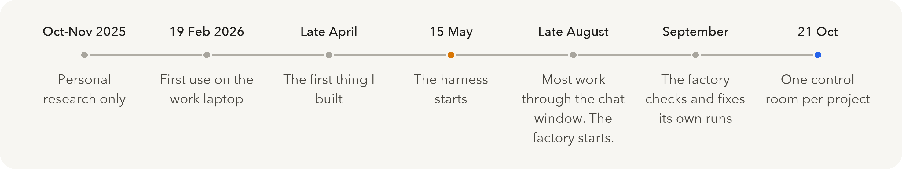

[[PIC 09]]

The stages follow a map of six. Work doesn't move up all at once - some work moves to the next stage and some stays.

<ol><li><strong>AI can't see the work.</strong> The raw data isn't digital, so I do it all myself.</li><li><strong>AI reads the work.</strong> Slack, email and meetings have a digital record AI can read, but the doing is still mine.</li><li><strong>AI does the work.</strong> I work from the chat window. AI acts when I ask, and I check what it did.</li><li><strong>AI runs the work.</strong> AI picks up work and gets it done. I approve, even from my phone.</li><li><strong>AI improves how the work is done.</strong> After every run, it checks what broke, fixes it and turns what it learned into skills.</li><li><strong>AI pushes the goal</strong> <strong>on its own.</strong> How that works is still unknown.</li></ol>

The factory was my first setup that picked up work by itself: Slack and email came in as tickets, and Claude worked on them every 20 minutes. It reached stage 5 in September. My own threads, even in control rooms, are still at stage 3 - rather than babysitting 20 threads, I'm babysitting 4, but it is still babysitting.

Over about two months, 867 pieces of work came into the factory as tickets, and 618 were closed. Then I shut it down for token burn. It is back today as the intake in section 1. I wrote about the factory <a href="2026-10-30-the-factory.html">here</a>.

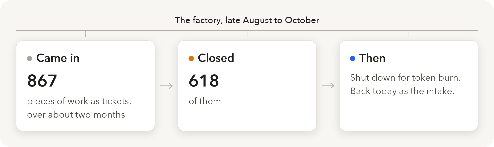

[[PIC 10]]

What made it different: a watcher and a fixer, two Claude sessions side by side. One found what broke after every run, the other fixed it - merged without me, and the next factory run, every 20 min, was on that new version. It caught the messages I'd have missed, and a first spec - a written plan of the work - was ready for me to comment on.

<strong>My job moved from watching threads → reviewing specs.</strong>

<strong>2. Time</strong>

About a year from first use, and about six months from first work use, until most of my work ran this way.

It did cost a lot of time to build the understanding, to connect, and to really continue to make it work. Basically 100% of my time was in the Claude window: doing the work, getting the harness, improving the harness. I never recorded the hours.

It took a lot more work than I expected. And <strong>the end state is still human-in-the-loop</strong> - self-improving and autonomous, but not without me.

<strong>3. Money</strong>

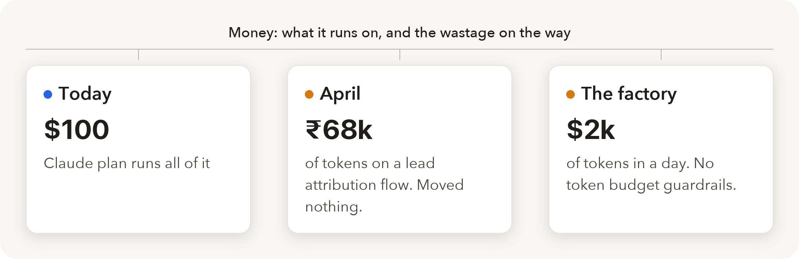

[[PIC 11]]

Today all of it runs on <strong>the $100 Claude plan</strong>.

There was wastage on the way.

In April, I was working on a lead acquisition attribution flow. It burned through about ₹68k worth of tokens. It did not move anything meaningful.

The factory burned through $2k of tokens in a day. I missed adding token budget guardrails. I wrote about both <a href="2026-10-30-tokens-are-a-resource.html">here</a>.

<strong>4. Errors in judgment</strong>

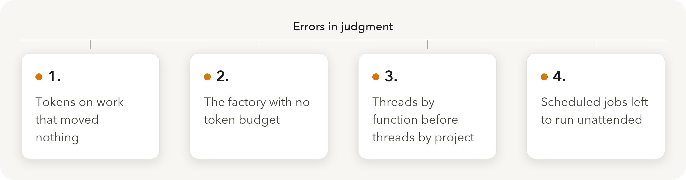

[[PIC 12]]

<ol><li>I spent tokens on work that moved nothing.</li><li>I ran the factory with no token budget.</li><li>I organised threads by function before I organised them by project - the story in section 1.</li><li>Scheduled jobs that ran unattended almost always failed.</li></ol>

Point 4 is about scheduled routines, like an end of day run. The 32 background jobs in section 2 are programs on my laptop.

<strong>5. People</strong>

Just me. No one else worked on the setup.

<h2>4. What it has done</h2>

<em>Mostly for: not AI-native yet.</em>

Going back to the two measures from the start.

<strong>First - business outcomes</strong>

Two examples

1. <strong>Company India</strong> <strong>Bookkeeping</strong> <strong>and Tax</strong> <strong>filings.</strong>

Before claude - for me it would have been almost impossible to attempt a flow like this. With Claude I first understood it. Then I built a system on top of that understanding. The monthly books now run through that system. I <a href="2026-11-16-ai-native-bookkeeping.html">wrote that one up separately</a>.

The CA firm's billing is <strong>down over 70% a month</strong>, for the same books. Human time spent is <strong>down 80%</strong>.

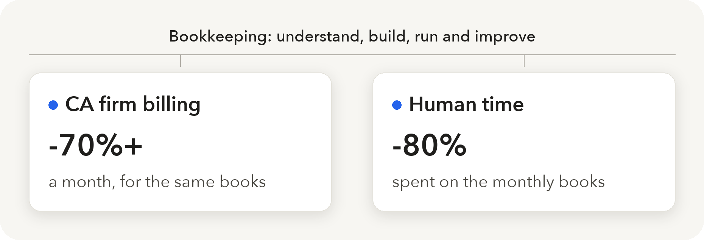

[[PIC 13]]

<strong>Product or software has to go to the domain, not the other way around.</strong> Any agentic system has to deeply understand the domain, get that understanding right, and use the tools - code, agents, evals - to run the domain

All of this is understanding of finance plus core system design, and both were very new to me. If the fundamentals of software are not there, then the quality will be off - way off. *(thats why system design is still *<em>basic)</em>

In the past, PMs were responsible for the outcome, and engineers would do the system design. <strong>Now the only thing that matters is the outcome.</strong> Anyone with an outcome mindset can drive it - even an accountant, at least for these kinds of flows.

2. <strong>Product</strong> <strong>Developement</strong>

Android, web, infra, email, internal apps and Kolo AI, our AI advisor for homeowners. Doing these on my own was <strong>not even remotely possible</strong>. Now I build, deploy and iterate at speed. The independence is liberating, only limited by capability

Before AI, if I wanted to understand the actual logic, I had to ask an engineer or reproduce the flow, because logic is written in the code. To understand the cloud cost for instance, I had to navigate the cloud console UI. It was a language I could not understand and access. Now I read both through Claude - no need to use any SaaS UI.

Since May, 662 code changes of mine have been merged, and 340 of those came in the last 30 days. 135 of them are product changes - the Android app, the website, the backend and internal apps.

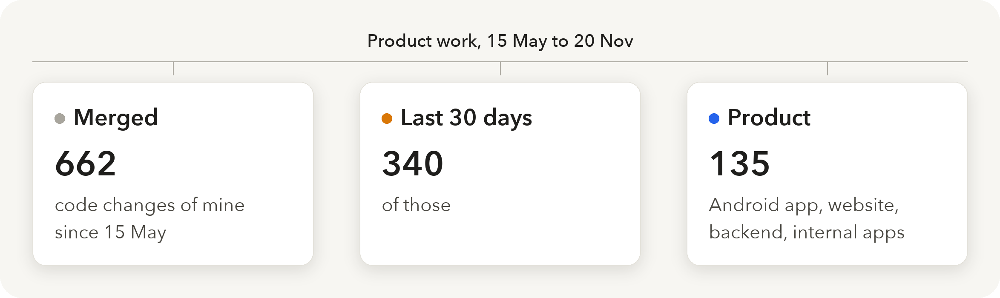

[[PIC 14]]

One real example - app subscribers on the lower plan can upgrade by paying only the difference. <strong>It was built in a day</strong>, on 5 Oct - the backend, the web version and the Android version. Earlier that would have easily taken at least a week.

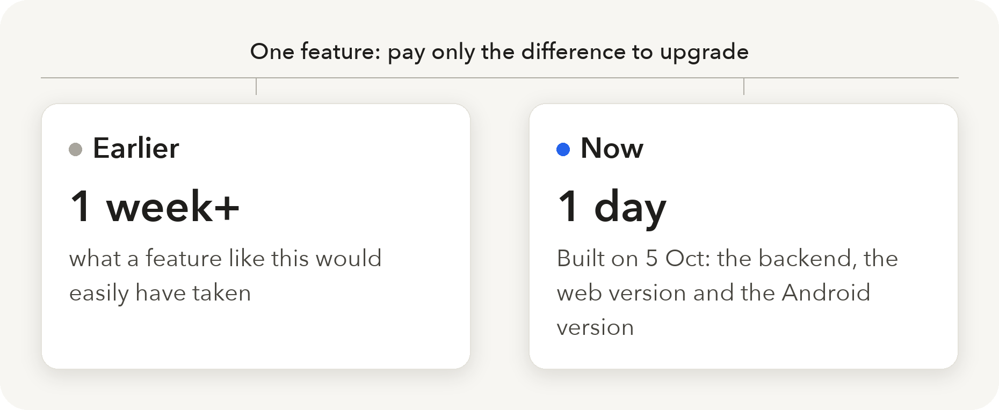

[[PIC 15]]

Take an Android change. I plug in my test phone. Claude checks the change end to end, backend and app, tapping through the app like a user.

<strong>Second measure - needed less and less for a task type</strong>

It's not binary that you do it once and then you are 100% out. <strong>The effort on a task type goes down in steps.</strong>

1. <strong>Emails to data licensing partners</strong> - companies that license our data

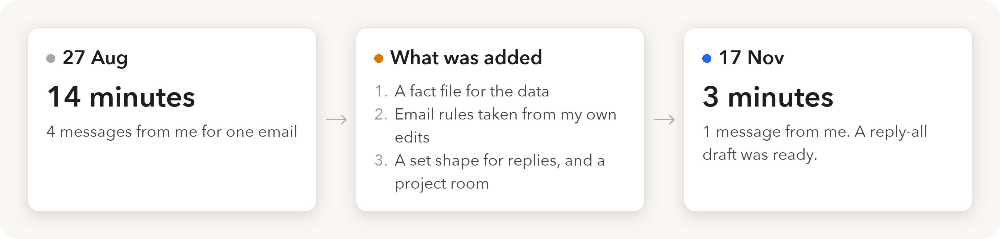

[[PIC 16]]

27 Aug: one email asking a partner for a quote took 4 of my messages and 14 minutes. I had to say which data to cite, which wording to drop and who it goes to. All Claude knew was the previous email. It also tried to send the email, and I stopped it.

17 Nov: one message from me. A reply-all draft with data samples attached was <strong>ready in 3 minutes</strong>.

What was added in between:

<ol><li>3 Sep: a fact file - one page of the facts about the data.</li><li>September: email rules taken from my own edits. Draft only, reply to all, keep it short.</li><li>October: a set shape for agreement replies, a standard intro, and a control room with its own threads.</li></ol>

I still send every email myself.

2. <strong>Product OPS</strong>

Traces how a new customer found us and posts it for the sales team was one such flow.

It started with many rounds of me filling gaps → a skill → a workflow I ran → runs by itself and posts on the sale thread

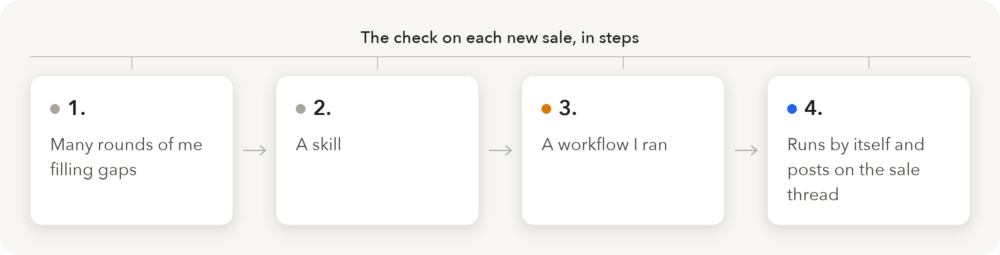

[[PIC 17]]

The same steps show in more task types. Counting my own typed messages per task type:

<ol><li>Tracing a new sale: &gt;50 in a month, then 0 across 10 runs from 31 Oct.</li><li>A finished onboarding into the CRM: 31, then 0 across 6 runs from 30 Oct.</li><li>These LinkedIn posts: 58 and 71 for the first two, then 23 once the rule became "I write, Claude lightly passes".</li></ol>

And it's like tens, probably hundreds, of task types like these - Slack replies, this LinkedIn writing and so on. For the same task type, a new task should take significantly less time.

Zero typed messages is not zero involvement. The decisions and the sends are still mine.

Where it hasn't dropped yet. The monthly books close took 184 of my typed messages for September, and about 176 so far for October. For Nov, 97 items waited for my go-ahead in Slack. And writing in my own voice is where I'm still needed most: the first article and the post before it took hundreds of turns.

And the other half of the second measure - taking up more task types. Bookkeeping and product above are both task types I could not take up earlier. Same with data licensing - Claude did the whole data licensing workstream, not only the emails.

That's where my attempt to become AI-native stands today. On the first measure, bookkeeping costs are down, and product work I could not do on my own I now build and deploy myself. On the second measure, I am needed less for some task types, and none is at zero. The setup and the harness are still being improved every day.

Next is to take up more ambitious, more different task types, so the leverage keeps compounding. <strong>A much reliable and predictable harness is needed first.</strong>

